# CST8913-Lab-3

**Student Name**: Collin MacLeod
**Student ID**: macl0379
**Course**: CST8915 Full-stack Cloud-native Development
**Semester**: Fall 2026

---

## Introduction

---

The purpose of this lab is to understand how templates can be used to deploy resources. This is demonstarted by creating a vm through a template to deploy a machine that follows these rules:

- Region: east us *east us was unavailable so sweden central was used*
- Availability Options: no infrastructure redundancy required
- Security Type: standard
- Image: ubuntu server 22.04 LTS
- Size: standard_b1ls -1 vcpu, 0.5 Gib memory *this size was unavailable, smallest size available was used*
- Authentication type:  password (include username and password in the template)
- Public inbound ports: None
- Os Disk type: Standard SSD
- Specify virtual network in the template
- NIC network security Group: None
- Load balancing options: None
- Add a tag

---

## Screenshots

---

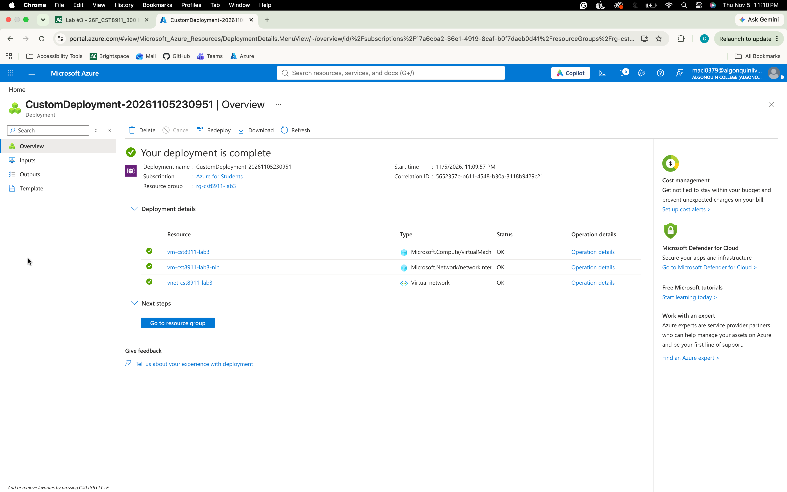
*Figure 1: Deployment complete for custom deployment, including VNet, VM and network interface*

---

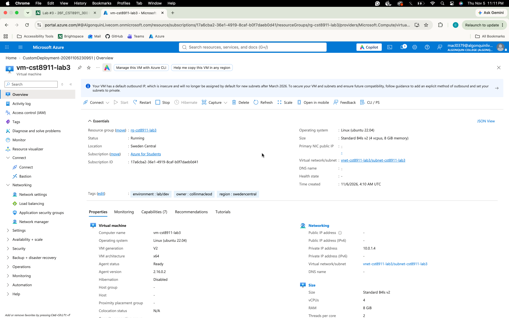
*Figure 2: VM Overview Screen displaying information including: Location, Tags and Networking*

*Figure 2.1: Location*

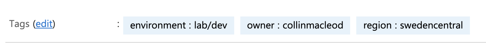
*Figure 2.2: Tags*

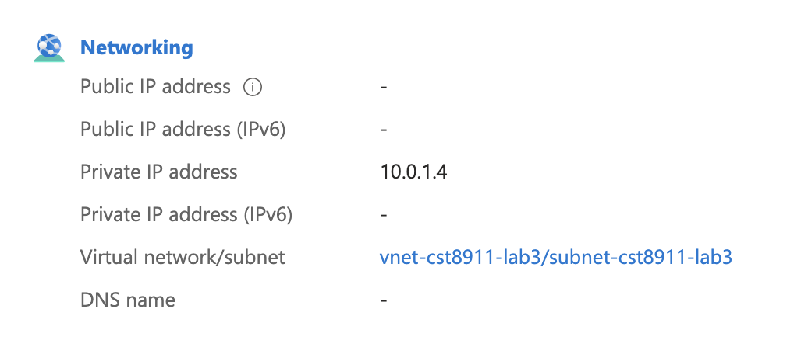
*Figure 2.3: Network settings*

---

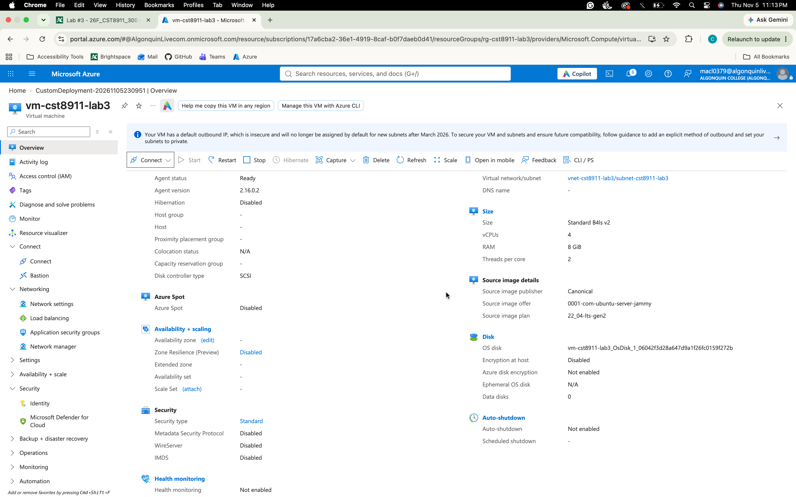
*Figure 3: Lower portion of VM Overview displaying information including: Availability, Security, Size, Source Image and Disk settings*

!!!!!!!!!
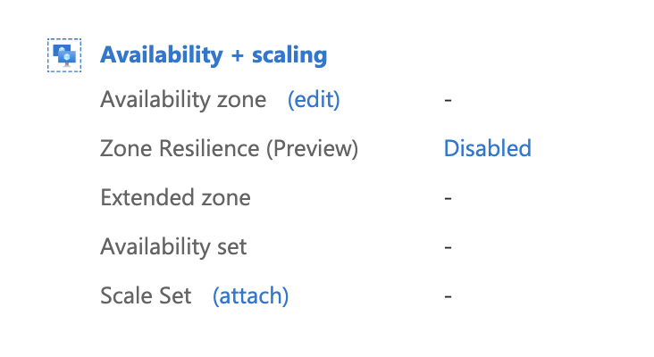
*Figure 3.1: Availability settings*

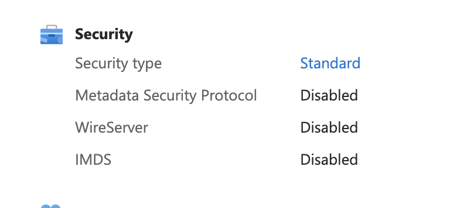
*Figure 3.2: Availability settings*

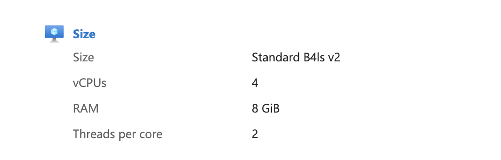
*Figure 3.3: Size settings*

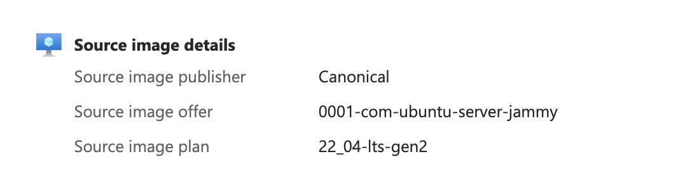
*Figure 3.4: Source Image settings*

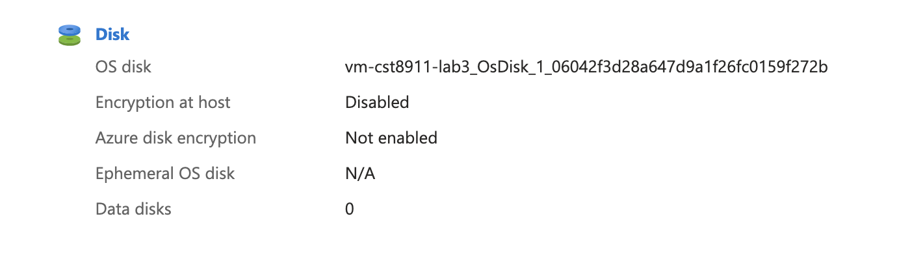
*Figure 3.5: Disk settings*

---

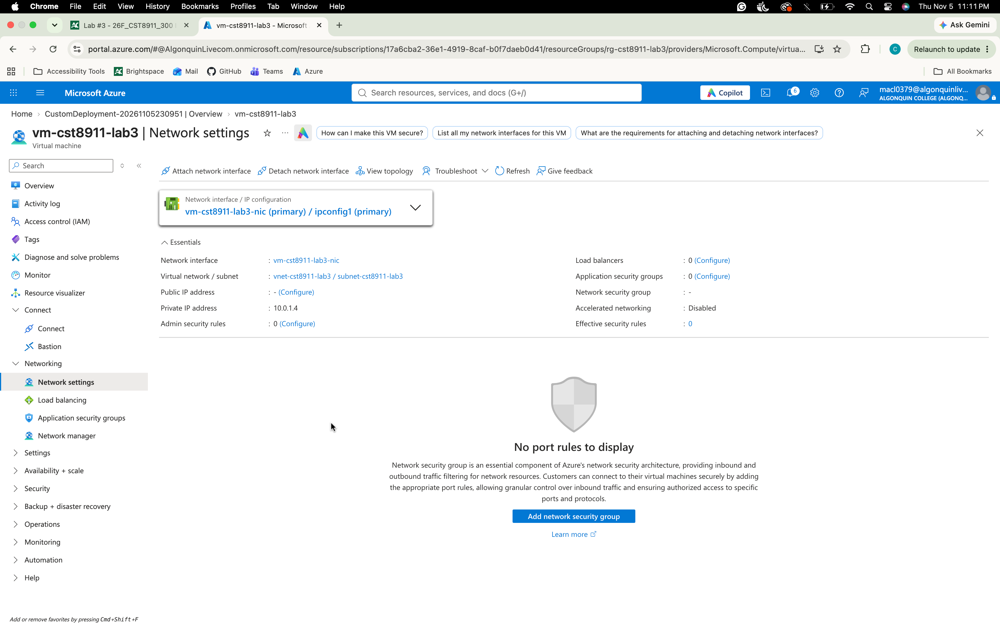
*Figure 4: Network settings page*

---

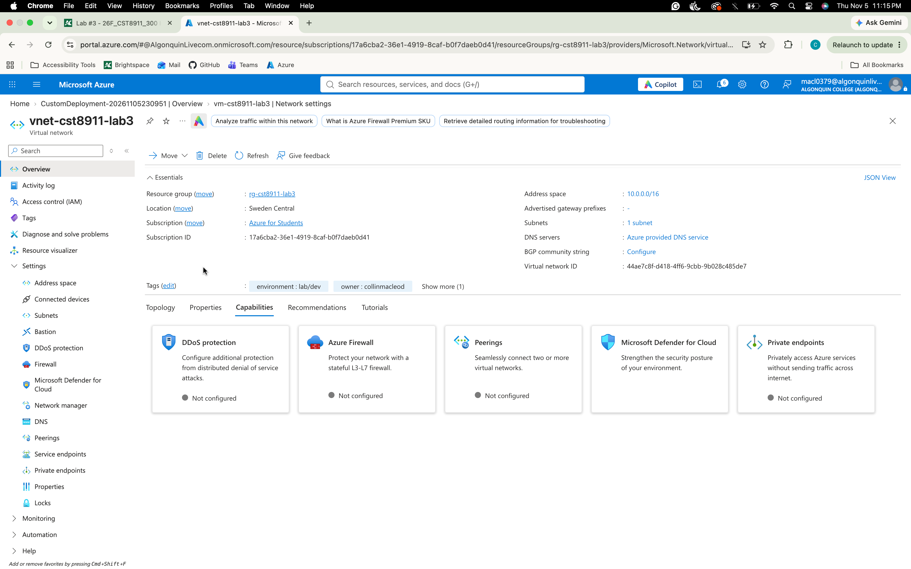
*Figure 5: VNet Overview page*

---

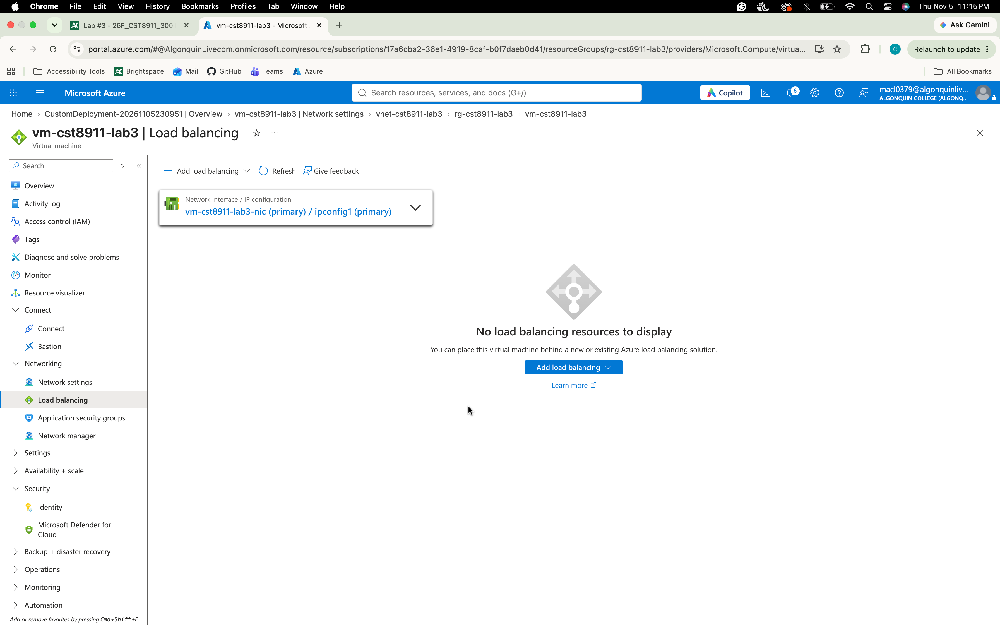
*Figure 6: Load balancing options page*

---

## Reflections

It is easy to see how the use of template can create consistent and quick deployments. While most setting can be explicit in the template some parameters need to be used in certain cases. If a set of resources needs the ability to be placed in various regions it is of course beneficial to have the ability to alter that without changing the template. The same goes for sizing as the availability isn't checked until after the validation of the deployment request.

